# Tugas 2 - Array Function

## Nama: Alya Rasyida Putri
## NIM: F1D02410002

## Deskripsi Tugas
Tugas ini dibuat untuk memahami dan juga mempraktikkan enam metode penting pada Array di JavaScript, yaitu `map()`, `filter()`, `reduce()`, `find()`, `some()`, dan `every()`. Data yang digunakan adalah daftar mata kuliah yang diambil pada semester ini dan ada juga mata kuliah semester sebelumnya, disusun dalam bentuk array of object dengan properti nama, kategori, jumlah SKS, kode mata kuliah, dan juga target nilai. Setiap metode diterapkan dengan kasus yang berbeda-beda sesuai dengan karakteristik data yang dibuat.

## Implementasi 6 metode (kode dan hasil Screenshot)
### map() 
- Tujuan: Mengambil nama seluruh mata kuliah saja dari data array of object, menghasilkan array baru berisi string nama dengan jumlah elemen yang sama seperti data asal.
- Screenshot:

  Kode:
  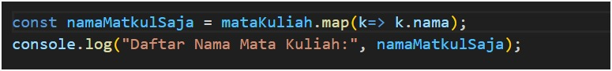

  Hasil eksekusi:
  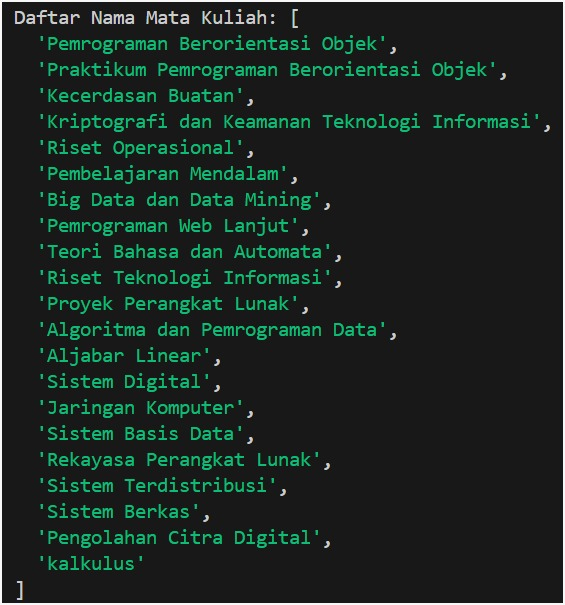

### filter()
- Tujuan: Menyaring mata kuliah yang termasuk kategori "pilihan", menghasilkan array baru berisi object mata kuliah yang jumlahnya lebih sedikit dari data asal.
- Screenshot:

  Kode:
  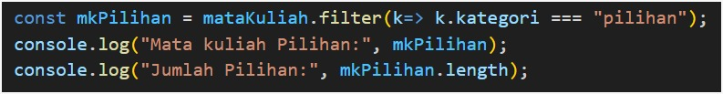

  Hasil eksekusi:
  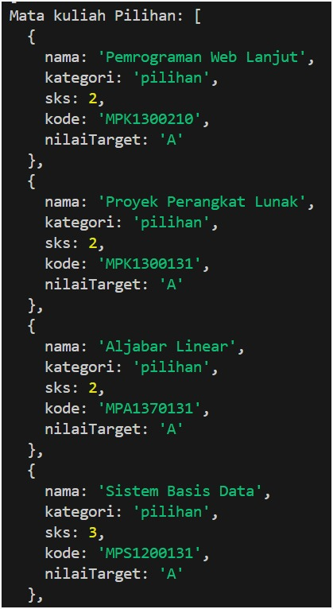
  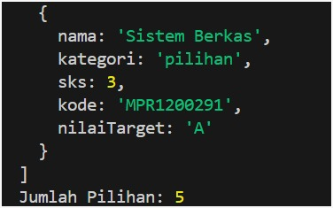

### reduce()
- Tujuan: Menghitung total keseluruhan SKS dari semua mata kuliah yang diambil menjadi satu nilai angka.
- Screenshot:

  Kode:
  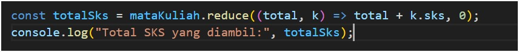

  Hasil eksekusi:
  

### find()
- Tujuan: Mencari satu mata kuliah tertentu berdasarkan kode mata kuliah yang spesifik.
- Screenshot:

  Kode:
  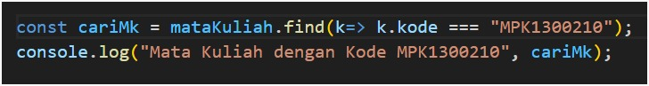

  Hasil eksekusi:
  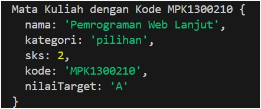

### some()
- Tujuan: Memeriksa apakah ada minimal satu mata kuliah dengan jumlah SKS lebih dari atau sama dengan 3.
- Screenshot:

  Kode:
  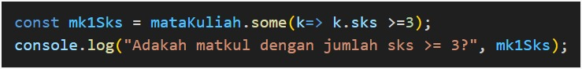

  Hasil eksekusi:
  

### every()
- Tujuan: Memeriksa apakah seluruh mata kuliah memiliki target nilai "A".
- Screenshot:

  Kode:
  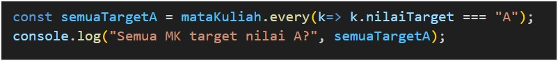

  Hasil eksekusi:
  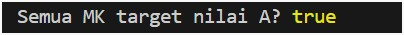

## Kesimpulan
Dari tugas ini saya jadi lebih paham perbedaan mendasar antar metode array di JavaScript, yang sebelumnya sering saya anggap mirip-mirip. map() dan filter() ternyata punya tujuan yang berbeda meskipun sama-sama menghasilkan array baru: map() mengubah bentuk setiap elemen tapi jumlahnya tetap sama seperti data asal, sedangkan filter() menyaring elemen mana saja yang lolos syarat tertentu sehingga jumlahnya bisa berkurang, namun bentuk tiap elemen yang lolos tetap utuh (semua properti object-nya tetap ikut). Saya juga sempat salah kira bahwa find() bisa dipakai untuk mencari banyak data sekaligus (misalnya semua mata kuliah dengan kode tertentu), padahal find() hanya mengembalikan satu elemen pertama yang cocok. Untuk mencari banyak elemen sekaligus, yang tepat digunakan adalah filter().

Metode reduce() saya gunakan untuk meringkas seluruh data menjadi satu nilai, dalam kasus ini menghitung total SKS semester. Di sini saya belajar pentingnya selalu memberi nilai awal pada reduce(), karena tanpa itu hasilnya bisa tidak sesuai harapan. Sementara some() dan every() sama-sama menghasilkan nilai boolean (true/false), tapi menjawab pertanyaan yang berbeda: some() mengecek apakah ada minimal satu elemen yang memenuhi syarat, sedangkan every() mengecek apakah semua elemen memenuhi syarat. Pada data saya, every() menghasilkan true karena seluruh mata kuliah memang saya targetkan mendapat nilai A.
